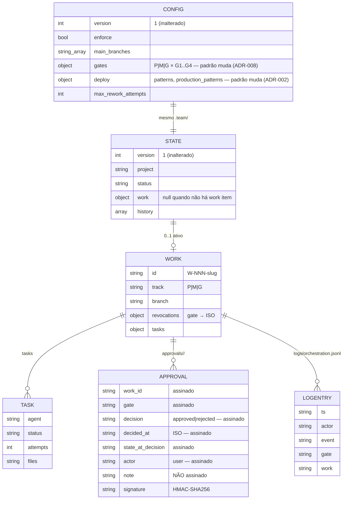

# Contratos internos — v1.1

Work item: W-001-evolucao-v1-1 · Status: proposto (aguarda G2)

Este arquivo faz, neste projeto, o papel de `docs/api/openapi.yaml` + `docs/data/model.md`: não há API HTTP
nem banco de dados, e os contratos que precisam ficar estáveis são o **CLI**, a **entrada/saída dos hooks** e
os **formatos em disco**. Tudo aqui é **contrato**: mudar exige ADR.

Convenções: `+` campo novo na v1.1 · `~` comportamento alterado · o resto é inalterado.

## 1. `lib/git.mjs` (novo — ADR-001)

```js
// --- fatos do git ---
export function findGitRoot(start): string | null        // sobe procurando .git (arquivo ou diretório), só fs
export function resolveBranch(cwd): BranchInfo           // no máximo 1 execução de git; memoizada
export function hasBaseCommit(cwd): boolean | null       // true | false | null (indeterminado); memoizada
export function gitWarnings(cwd, mainBranches): string[] // [] quando não há nada a avisar

// --- frases de fonte única (§6) ---
export function missingBaseCommitMessage(branch): string
export function unknownBranchMessage(detail): string

// --- apoio ---
export function normalizeBranchInfo(value): BranchInfo   // string | null | BranchInfo → BranchInfo
export function resetGitCache(): void                    // USO EXCLUSIVO DE TESTE

// BranchInfo
{ kind: 'branch' | 'detached' | 'no-repo' | 'unknown',
  name: string | null,   // só em kind:'branch'
  detail?: string }      // motivo, quando kind:'unknown' (sem caminho absoluto de segredo)
```

Implementação fixada:

| passo | comando | resultado |
|---|---|---|
| 1 | `findGitRoot(cwd)` (sem spawn) | `null` ⇒ `{kind:'no-repo'}` |
| 2 | `git -C <cwd> symbolic-ref --quiet --short HEAD` | exit 0 com nome ⇒ `{kind:'branch', name}` · exit 0 vazio ⇒ `{kind:'unknown'}` · **exit 1 ⇒ `{kind:'detached'}`** · erro de spawn/timeout/outro status ⇒ `{kind:'unknown', detail}` |
| 3 (preguiçoso) | `git -C <cwd> rev-parse --verify --quiet HEAD` | exit 0 ⇒ `true` · exit 1 ⇒ `false` · resto ⇒ `null` |

Verificado (2026-09-17, este repositório e `tests/git.test.mjs`): branch sem commits ⇒ nome com exit 0;
com commit ⇒ nome com exit 0; **HEAD destacado ⇒ stdout vazio com exit 1** (cai em `detached`, mantendo o
CA-01.7); fora de repositório ⇒ exit 128; `git` fora do PATH ⇒ `ENOENT` ⇒ `unknown`.

Todas as execuções: `execFileSync('git', [...], { encoding:'utf8', timeout: 3000, stdio:['ignore','pipe','ignore'] })`.
`resolveBranch` e `hasBaseCommit` memoizam por `path.resolve(cwd)` no escopo do módulo (o CLI chama duas vezes
no `status`; medido: 31 ms a frio, 0,27 ms para 100 chamadas memoizadas).

### Quem pode consumir cada export

| export | guard (`guard-rules.mjs`) | CLI (`bin/team.mjs`) | testes | observação |
|---|---|---|---|---|
| `resolveBranch` | **sim** | sim | sim | única forma de saber a branch; `currentBranch`/`execFileSync` local do guard tem de sair |
| `hasBaseCommit` | **sim**, só para compor a mensagem de bloqueio | sim | sim | preguiçosa por causa do RNF-03 |
| `findGitRoot` | sim | sim | sim | sem spawn |
| `gitWarnings` | **não** | **sim** (`status`, `init`) | sim | é formatação para o usuário, não regra de bloqueio |
| `missingBaseCommitMessage` | **sim** (acrescenta à mensagem, CA-01.1) | sim (via `gitWarnings`) | sim | fonte única: faixa A e faixa B usam a mesma frase |
| `unknownBranchMessage` | **sim** (mensagem do CA-01.2) | sim (via `gitWarnings`) | sim | idem |
| `normalizeBranchInfo` | **sim**, no ponto de injeção `deps.getBranch` | não | sim | só existe para a compatibilidade de teste do ADR-001 |
| `resetGitCache` | **não** | **não** | sim | processos de hook e de CLI são curtos; chamar isso em produção anula a memoização do RNF-03 |

`gitWarnings(cwd, mainBranches)` devolve, no máximo, uma frase por situação:

- branch principal sem commit base ⇒ `[missingBaseCommitMessage(branch)]`
- `kind:'unknown'` ⇒ `[unknownBranchMessage(detail)]`
- `kind:'no-repo'` ⇒ `[]`, **nenhum aviso** (CA-01.6)
- `kind:'detached'` ou branch fora de `main_branches` ⇒ `[]` (nada a avisar; CA-01.7)

**Texto das duas frases** (as duas são lidas tanto pelo usuário, via CLI, quanto pelo agente, via mensagem de
bloqueio do guard, então nenhuma delas pode falar na segunda pessoa — um `Crie-o você mesmo` lido pelo agente o
convidaria a fazer exatamente o que a regra proíbe):

- `missingBaseCommitMessage(branch)` →
  `Este repositório ainda não tem o commit base em <branch>. O commit base tem de ser criado pelo usuário, no terminal dele (agentes não commitam na principal), antes de IMPLEMENTING; depois o Orchestrator cria a branch do work item a partir dele.`
- `unknownBranchMessage(detail)` →
  `Não foi possível identificar a branch atual (<detail>). Comandos que alteram histórico ficam bloqueados até isso ser resolvido; peça ao usuário para verificar o repositório.`

## 2. CLI `team` — mudanças

Nenhum comando, opção ou código de saída é removido ou renomeado. Códigos de saída: `1` erro geral,
`3` aprovação ausente, `4` limite de retrabalho.

### `team status`
- `~` texto: quando `gitWarnings()` não é vazio, cada aviso entra como uma linha própria começando com `⚠️ `,
  logo depois da linha `Estado:` (CA-01.3).
- `+` `--json`: chave nova de primeiro nível (aditiva, ADR-007):

```json
"git": {
  "repo": true,
  "branch": "main",
  "branch_kind": "branch",          // branch | detached | no-repo | unknown
  "has_base_commit": false,          // true | false | null
  "warnings": ["Este repositório ainda não tem o commit base em main. ..."]
}
```
  Sem git: `{"repo": false, "branch": null, "branch_kind": "no-repo", "has_base_commit": null, "warnings": []}`.

### `team init`
- `~` além da linha atual, imprime os avisos de `gitWarnings()` (CA-01.4) e uma linha por trilha com os gates
  ligados (CA-06.3), por exemplo: `Gates por trilha: P → G3, G4, PROD | M → G1..G4, PROD | G → G1..G4, PROD`.

## 3. Hook `PreToolUse` (`hooks/guard.mjs`)

Entrada (do harness): `{ tool_name, tool_input, cwd, ... }`. Saída: exit `0` libera, exit `2` bloqueia com o
motivo em **stderr**. `stdout` continua sempre vazio.

- `~` exit 2 também quando a avaliação lança exceção **e** o diretório tem time ativo (ADR-005).
- Formato do bloqueio (inalterado): `[agent-team] BLOQUEADO: <motivo>\nNão tente contornar este bloqueio com outro comando. Pare e reporte ao Orchestrator/usuário.\n`

`guard-rules.mjs` expõe, além do que já expõe:

```js
export function enforcementContext(input): { root: string|null, enforcing: boolean }
export function searchTargets(toolName, toolInput, cwd): string[]   // ADR-003
export function classifyGitCommand(command, mainBranches): GitAction | null  // ADR-001
```

`evaluateToolCall(input, deps)` mantém a assinatura e o ponto de injeção `deps.getBranch`. `~` `deps.getBranch`
passa a poder devolver um `BranchInfo`; quando devolve `string`, é normalizado para `{kind:'branch', name}` e,
quando devolve `null`, para `{kind:'unknown'}` (mantém os testes atuais compilando — ver ADR-001).

## 4. Hook `UserPromptSubmit` (`hooks/prompt-approval.mjs`)

Entrada: `{ prompt, cwd, ... }`. Saída em `stdout`:
`{"hookSpecificOutput":{"hookEventName":"UserPromptSubmit","additionalContext":"<texto>"}}` — formato
**validado no harness real** (RNF-06 a). `stdout` vazio = nada a dizer. Nunca sai com código diferente de 0.

`lib/prompt-rules.mjs` (novo):

```js
export function classifyPrompt(prompt): {
  kind: 'none' | 'decision' | 'intent',
  verb: 'approve' | 'reject' | null,
  gate: 'G1'|'G2'|'G3'|'G4'|'PROD' | null,
  note: string,
  typed: string        // a primeira linha original, aparada, para ecoar no aviso
}
```

Tabela de classificação da **primeira linha** (ADR-006 detalha; `T` = tokens da linha sem pontuação final):

| linha | kind | efeito |
|---|---|---|
| `APROVAR G1` | decision/approve | registra; aviso de sucesso |
| `REPROVAR G1 motivo` | decision/reject | registra com motivo; aviso de sucesso |
| `APROVAR` / `APROVO` / `APROVADO` | intent/approve | **não registra**; aviso com o comando exato |
| `APROVAR G9`, `APROVAR GX`, `APROVAR G0` | intent/approve | idem |
| `REPROVAR`, `REJEITO`, `REPROVAR G9 ...` | intent/reject | idem, com `<motivo>` no comando sugerido |
| `APROVAR G1 mas mude o RF-02` | none | silêncio (conversa) |
| `acho que dá pra APROVAR G1`, `ok, pode seguir` | none | silêncio |

## 5. Estado e formatos em disco (modelo de dados)



**Congelado na v1.1** (ADR-007): `signable(rec) = JSON.stringify([work_id, gate, decision, decided_at, state_at_decision, actor])`,
o nome e o local do arquivo da chave, os nomes `approvals/<work>/<gate>.json` e `<gate>.rejected.json`, e
`version: 1` em config e estado. Mudança em qualquer um deles invalida as aprovações já dadas neste work item.

## 6. Mensagens (RNF-05, RNF-10)

| situação | prefixo | obrigatório |
|---|---|---|
| bloqueio do guard | `[agent-team] BLOQUEADO: ` | motivo + quem faz o quê a seguir |
| aviso do hook de prompt | `[agent-team] ` (sem `BLOQUEADO`) | dizer que **NADA foi aprovado ou reprovado** + comando exato |
| erro interno do guard | `[agent-team] BLOQUEADO: ` em stderr | identificar "erro interno do guard" + pedir para reportar ao usuário |
| avisos do CLI | `⚠️ ` na linha | quem cria o commit base e quando |

Nenhuma mensagem, log, teste ou aviso imprime o conteúdo da chave, nem o caminho completo dela quando puder
ser evitado (RNF-04). Tudo em português; identificadores de código em inglês.

## 7. Smoke do deploy — RNF-06 (b)

Roteiro a executar na fase `DEPLOYING`, com o runtime v1.1 instalado em diretório alternativo
(`--claude-dir`), numa sessão real, registrando a evidência em `.team/work/W-001-evolucao-v1-1/results/`:

1. `APROVAR G4` (ou o gate em espera) devolve o aviso de sucesso via `additionalContext`.
2. Mensagem só com `APROVAR` devolve o aviso da US-08 com o gate em espera e o comando exato.
3. Um comando bloqueado (por exemplo `git merge` fora de `MERGING`) devolve `[agent-team] BLOQUEADO:`.
4. Uma busca com Grep por `.claude/team` **dentro do projeto** é permitida; com alvo no diretório do runtime
   instalado é bloqueada.
5. O `G1.json` assinado pela v1.0 continua válido (`team status --json` mostra `G1.approved = true`).
