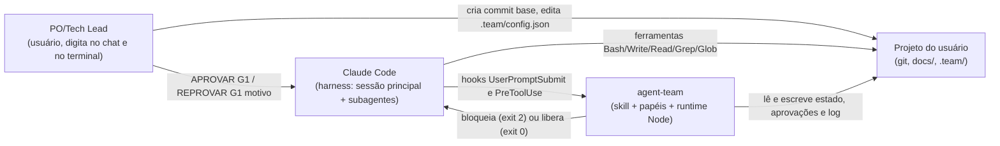
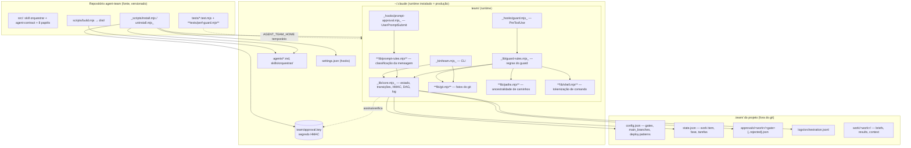
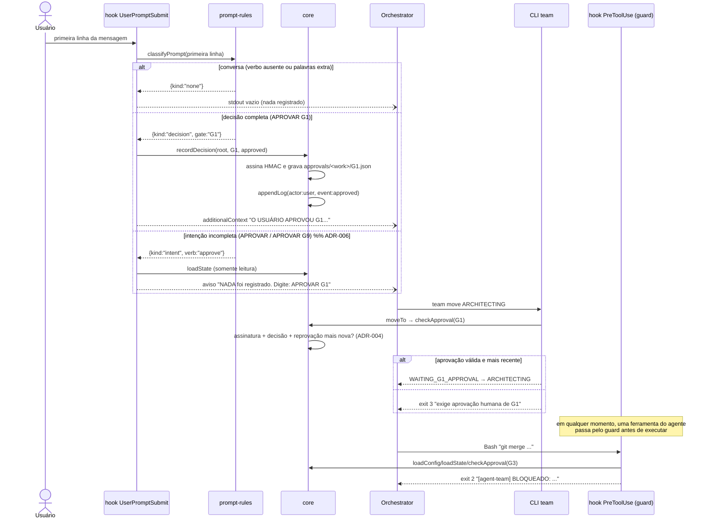
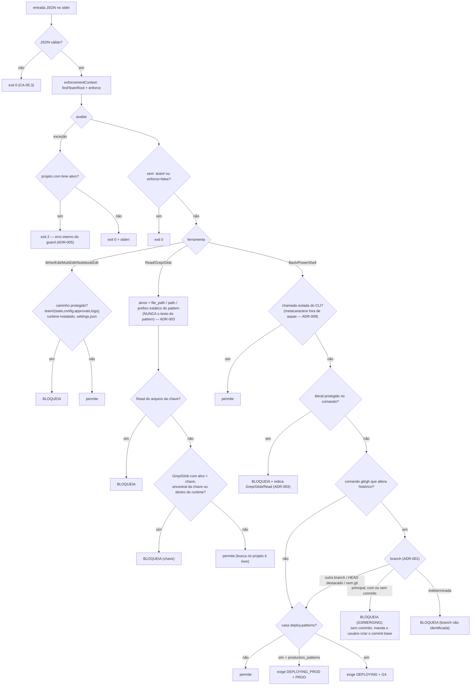

# Visão de arquitetura — runtime do agent-team (v1.1)

Work item: W-001-evolucao-v1-1 · Data: 2026-09-17 · Status: proposto (aguarda G2)

Este documento descreve **o que existe hoje (v1.0)** e **o que muda na v1.1**. As decisões estão nos ADRs
(`adr-001` a `adr-010`); os contratos internos (CLI, hooks, config, estado, aprovações) estão em
[`contracts.md`](./contracts.md).

> Não há `docs/api/openapi.yaml` nem `docs/data/model.md` neste projeto: não existe API HTTP nem banco de
> dados. O papel desses artefatos é cumprido por `contracts.md` (contratos internos) e pela seção
> "Estado e formatos" dele (modelo de dados em arquivos JSON).

## Contexto (C4 nível 1)

## Containers e componentes (C4 nível 2, v1.1)

Em **negrito**, o que a v1.1 cria; em _itálico_, o que a v1.1 altera.

### Responsabilidade de cada módulo

| Módulo | Responsabilidade | Muda na v1.1 |
|---|---|---|
| `lib/core.mjs` | formatos, transições, aprovações assinadas, DAG, log. **Sem git, sem regex de shell** | defaults de deploy (ADR-002), `checkApproval` (ADR-004), `defaultConfig` (ADR-008) |
| `lib/guard-rules.mjs` | decisão pura `evaluateToolCall(input) → {deny, reason}` | integra `git.mjs`/`paths.mjs`/`shell.mjs`, expõe `enforcementContext` |
| **`lib/git.mjs`** | único lugar que executa `git`; devolve fatos estruturados | novo (ADR-001) |
| **`lib/paths.mjs`** | normalização e ancestralidade de caminhos (Windows, UNC, caixa) | novo (ADR-003) |
| **`lib/shell.mjs`** | separa texto citado de metacaracteres reais | novo (ADR-009) |
| **`lib/prompt-rules.mjs`** | classifica a primeira linha da mensagem do usuário | novo (ADR-006) |
| `hooks/guard.mjs` | I/O do hook + política de falha (fail-closed escopado) | ADR-005 |
| `hooks/prompt-approval.mjs` | I/O do hook + registro da decisão + avisos | ADR-006 |
| `bin/team.mjs` | CLI: fase, tarefas, status, avisos de bootstrap | ADR-001, ADR-008 |

**Regra de dependência:** `core.mjs` não importa nada do guard; `guard-rules.mjs` importa `core.mjs` e as
libs novas; os hooks e o CLI não contêm regra de negócio, só I/O e formatação de mensagem. `git.mjs` é o
**único** módulo que chama `execFileSync`.

## Fluxo de decisão de um gate (v1.1)

## Pontos de bloqueio do guard (v1.1)

## Rastreabilidade — história/requisito → decisão

| História | RF/RNF | Decisão | Onde muda |
|---|---|---|---|
| US-01 | RF-01, RF-02 | ADR-001 | `lib/git.mjs` (novo), bloco git de `guard-rules.mjs`, `bin/team.mjs` |
| US-02 | RF-03, RF-04 | ADR-002 | `DEFAULT_DEPLOY_PATTERNS` / `DEFAULT_PRODUCTION_PATTERNS` em `core.mjs` |
| US-03 | RF-05, RF-06, RF-07 | ADR-003 | `lib/paths.mjs` (novo), bloco Read/Grep/Glob e `shellPathReason` |
| US-04 | RF-08, RF-09 | ADR-004 | `checkApproval` em `core.mjs` |
| US-05 | RF-10 | ADR-005 | `hooks/guard.mjs` + `enforcementContext` em `guard-rules.mjs` |
| US-06 | RF-11 | ADR-008 | `defaultConfig` em `core.mjs`, saída de `team init` |
| US-07 | RF-12 | ADR-009 | `lib/shell.mjs` (novo), `isStandaloneTeamCall` |
| US-08 | RF-13, RF-14 | ADR-006 | `lib/prompt-rules.mjs` (novo), `hooks/prompt-approval.mjs` |
| RNF-01 | compatibilidade | sem dependências; só `node:*`; `path` da plataforma (ADR-003) | — |
| RNF-02 | testabilidade | ADR-004 e ADR-006 listam os 2 testes existentes que mudam, com o CA que justifica | `tests/**` |
| RNF-03 | desempenho | ADR-001: 1 spawn de git no caminho comum, 2º só quando já vai bloquear; `tests/perf-guard.mjs` | — |
| RNF-04 | segurança | ADR-003 (alvo, não padrão) + ADR-005 (fail-closed escopado); nenhuma mensagem imprime a chave | — |
| RNF-05 | usabilidade | `contracts.md` §"Mensagens" fixa prefixo, idioma e próximo passo | — |
| RNF-06 | harness | (a) atendido; (b) smoke em DEPLOYING, roteiro em `contracts.md` §"Smoke" | — |
| RNF-07 | **migração** | **ADR-007** (assinatura congelada, `version` mantida, leitura tolerante) | — |
| RNF-08 | auditoria | ADR-004 (log de toda decisão) + ADR-005 (erro interno em stderr) | — |
| RNF-09 | documentação | `README.md` + `CHANGELOG.md` + `SKILL.md` §bootstrap/§CLI | fora de `runtime/` |
| RNF-10 | idioma | mensagens em português, identificadores em inglês | — |
| B-12 | mitigação | ADR-010 | `.team/config.json` deste repo (o usuário aplica) |

## Riscos arquiteturais

1. **Fail-closed pode travar o próprio conserto** (ADR-005): se a v1.1 instalada tiver um bug nas regras, todo
   projeto com time ativo bloqueia. Escape documentado: o usuário põe `"enforce": false` na config do projeto
   (edição manual, que nenhum agente consegue fazer). O smoke do RNF-06 (b) tem que exercitar exatamente isso.
2. **Configs existentes não recebem os novos `deploy.patterns`** (ADR-002/ADR-007, `loadConfig` substitui o
   array). Projetos antigos, inclusive este, continuam desprotegidos até o usuário editar a config.
3. **Ancestralidade lexical não cobre link simbólico/junction** para dentro da árvore da chave (ADR-003). É
   limite conhecido: o guard protege contra erro do modelo, não contra burla deliberada.
4. **Duas tarefas disputam `core.mjs` e quatro disputam `guard-rules.mjs`**: o plano técnico do resultado
   serializa essas tarefas em duas faixas (lanes) de arquivos disjuntos.
